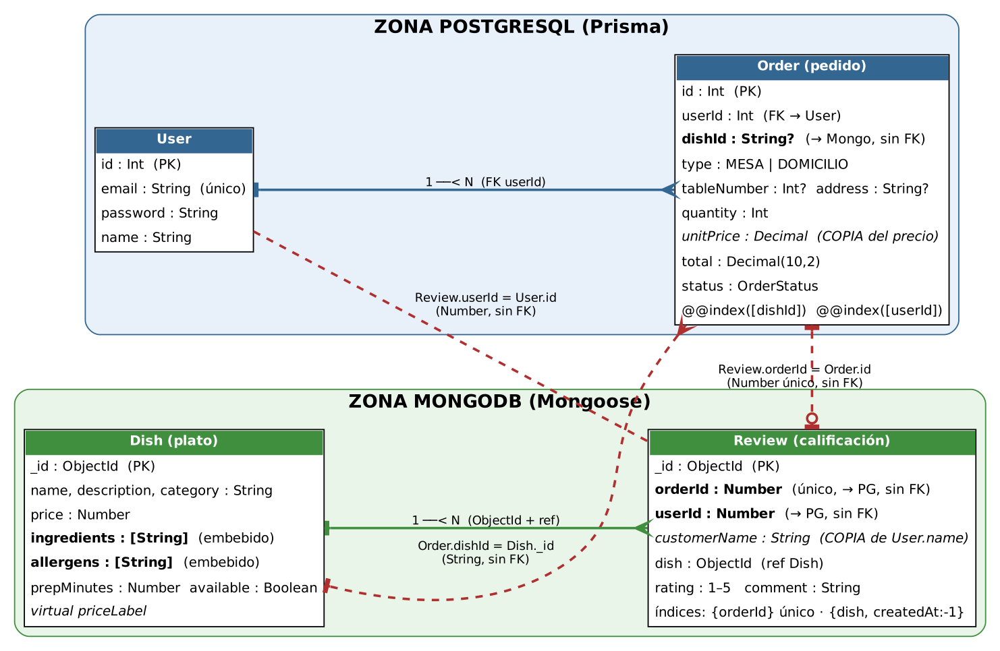
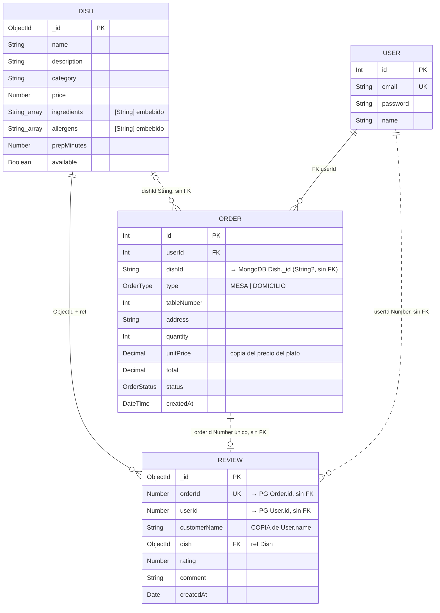

# Tarea individual U2 · Modelo híbrido PostgreSQL + MongoDB

**Estudiante:** Jonathan Guayta **N.º de lista:** 06  **Caso:** 6 - Restaurante

## 1. Workload

### 1.1 Casos de uso

- Un restaurante recibe pedidos de clientes registrados, para consumir en una **mesa** o para **domicilio**.
- El cliente consulta el menú (platos con ingredientes y alérgenos), hace su pedido y ve su historial.
- Cuando el pedido se entrega, el cliente lo **califica** (1 a 5 y un comentario).
- Cualquiera puede leer las calificaciones y el promedio de un plato.
- El administrador mantiene el menú, que **cambia cada semana**.

### 1.2 Datos principales (cuántos actores, cuántos registros, cuánto tiempo se guardan)

- Clientes registrados: ~1 500 (crecen ~40 por mes).
- Platos activos en el menú: ~25 (rotan cada semana; cada plato tiene un número distinto de ingredientes y alérgenos).
- Pedidos: ~250 por día (~91 000 al año).
- Calificaciones: ~100 por día (~40 % de los pedidos). **Crecen sin límite.**
- Período: pedidos y calificaciones se guardan 2 años (control tributario y reputación).

### 1.3 Suposiciones (lo que puede cambiar)

- El pedido necesita un **total exacto** (dinero con 2 decimales), por eso se calcula en centavos enteros.
- Un pedido tiene como máximo **una** calificación, y solo si ya fue entregado.
- El precio de un plato puede cambiar cada semana, pero un pedido ya hecho **no** debe cambiar de valor: el pedido guarda una copia del precio.
- El nombre de un cliente casi nunca cambia: se puede copiar en la calificación.
- El menú se lee muchísimo más de lo que se escribe, y cada plato puede tener campos distintos.
- Las calificaciones se muestran por plato, las más nuevas primero, con el promedio.

### 1.4 Operaciones (mínimo 6, una tabla por operación)

| Actor: | Cliente |
|---|---|
| Descripción: | Crea un pedido (mesa o domicilio) eligiendo un plato |
| Tipo de operación: | Escritura |
| Datos en la operación: | dishId, quantity, type, tableNumber/address; userId del JWT; total calculado (precio × cantidad) |
| Frecuencia: | Picos en almuerzo (12–14 h) y cena (19–21 h) |
| Tasa: | 250 / día |
| Base: | **PostgreSQL** (el pedido necesita total exacto e integridad); lee MongoDB para validar `dishId` y obtener el precio |

| Actor: | Cliente |
|---|---|
| Descripción: | Ve su historial de pedidos con el nombre y los ingredientes de cada plato |
| Tipo de operación: | Lectura |
| Datos en la operación: | pedidos (PostgreSQL) + name, category, ingredients, allergens (MongoDB) |
| Frecuencia: | Cada cliente activo, ~1 vez al día |
| Tasa: | ~600 / día |
| Base: | **Las dos**: se une en el servicio con `$in` + `Map` (2 consultas, sin N+1) |

| Actor: | Cliente (o visitante) |
|---|---|
| Descripción: | Consulta el menú: lista, búsqueda por nombre, filtro por categoría |
| Tipo de operación: | Lectura |
| Datos en la operación: | name, description, category, price, ingredients[], allergens[] |
| Frecuencia: | En cada visita a la página del menú |
| Tasa: | ~3 000 / día |
| Base: | **MongoDB** (documento listo para mostrar, forma variable por plato) |

| Actor: | Cliente |
|---|---|
| Descripción: | Califica un pedido ya entregado (1 a 5 estrellas y comentario) |
| Tipo de operación: | Escritura |
| Datos en la operación: | orderId, rating, comment; userId del JWT; customerName copiado de PostgreSQL; dish tomado del pedido |
| Frecuencia: | ~40 % de los pedidos |
| Tasa: | ~100 / día (sin límite en el tiempo: ~73 000 en 2 años) |
| Base: | **MongoDB**, colección aparte; lee PostgreSQL para validar que el pedido exista (404) y sea suyo (403) |

| Actor: | Cliente (o visitante) |
|---|---|
| Descripción: | Lee las calificaciones de un plato con su promedio |
| Tipo de operación: | Lectura |
| Datos en la operación: | customerName, rating, comment, createdAt; promedio y total |
| Frecuencia: | Al abrir el detalle de un plato |
| Tasa: | ~1 500 / día |
| Base: | **MongoDB** solamente (por eso se copia `customerName`) |

| Actor: | Mesero |
|---|---|
| Descripción: | Cambia el estado del pedido (PENDIENTE → EN_PREPARACION → ENTREGADO) |
| Tipo de operación: | Escritura |
| Datos en la operación: | orderId, status |
| Frecuencia: | ~3 cambios por pedido |
| Tasa: | ~750 / día |
| Base: | **PostgreSQL** (transición de estado consistente) |

| Actor: | Administrador |
|---|---|
| Descripción: | Crea o edita un plato del menú |
| Tipo de operación: | Escritura |
| Datos en la operación: | name, category, price, ingredients[], allergens[], prepMinutes, available |
| Frecuencia: | El menú cambia cada semana |
| Tasa: | ~10 / semana |
| Base: | **MongoDB** |

| Actor: | Administrador |
|---|---|
| Descripción: | Elimina un plato |
| Tipo de operación: | Escritura |
| Datos en la operación: | _id; conteo de pedidos que lo usan |
| Frecuencia: | Casi nunca |
| Tasa: | ~5 / mes |
| Base: | **MongoDB**, revisando PostgreSQL (409 si hay pedidos; si no, borra sus calificaciones en cascada) |

### 1.5 Entidades

- **PostgreSQL**
  - User
    - Order (1:N, FK `userId`)
- **MongoDB**
  - Dish
    - ingredients[] (embebido)
    - allergens[] (embebido)
    - Review (1:N, `dish` ObjectId + ref)
- **Entre bases (sin FK)**
  - Order.dishId → Dish._id (String?)
  - Review.orderId → Order.id (Number, único)
  - Review.userId → User.id (Number) · Review.customerName (copia de User.name)

### 1.6 Observaciones (qué domina: lectura o escritura, qué crece sin límite, qué necesita integridad)

- Dominan las **lecturas**: ~5 100 al día (menú, historial, calificaciones) frente a ~1 100 escrituras (pedidos, cambios de estado, calificaciones): unas **5 lecturas por escritura**. Por eso lo que más se lee (menú y calificaciones) sale de una sola colección de MongoDB.
- Lo único que **crece sin límite** son las calificaciones: van en su propia colección, nunca embebidas en el plato (límite de 16 MB por documento).
- El pedido **necesita integridad** (total exacto, pertenece a un usuario, estados válidos): se queda en PostgreSQL.
- El menú **cambia de forma** (ingredientes y alérgenos distintos por plato, platos nuevos cada semana): encaja en documentos de MongoDB.
- Índices que pide el workload: `orders.dishId` y `orders.userId` (PostgreSQL); `reviews.orderId` único y `reviews { dish: 1, createdAt: -1 }` (MongoDB).

## 2. ¿PostgreSQL o MongoDB?

| Entidad | ¿Transacciones o choques? | ¿Otras dependen por FK? | ¿Forma variable? | ¿Crece sin límite? | ¿Se lee mucho más? | Base |
|---|---|---|---|---|---|---|
| User | Sí: el email es único y guarda credenciales | Sí: `Order.userId` | No | Poco (~40/mes) | No | **PostgreSQL** |
| Order (pedido) | Sí: total exacto y estados consistentes | No (solo el registro de MongoDB apunta a su `id`, sin FK) | No: siempre los mismos campos | Sí, pero de forma controlada (~91 000/año) | No: se escribe ~4 veces por cada lectura propia | **PostgreSQL** |
| Dish (plato) | No: nadie “choca” por un plato | **No**: `Order.dishId` es un String sin FK | **Sí**: ingredientes[] y alérgenos[] distintos | No (~25 activos) | **Sí** (~3 000 lecturas/día) | **MongoDB** |
| Review (calificación) | No (solo un índice único por pedido) | No | Poco, pero viene con comentario libre | **Sí**, sin límite | Sí (~1 500 lecturas/día) | **MongoDB** |

## 3. Relaciones dentro de MongoDB: embeber o referenciar

| Relación | Cardinalidad | ¿Se lee junto? | ¿Cambia seguido? | ¿Crece sin límite? | Decisión |
|---|---|---|---|---|---|
| Dish → ingredients[] | 1:pocos (3–15) | Sí, siempre con el plato | No | No | **Embeber** |
| Dish → allergens[] | 1:pocos (0–7, lista cerrada) | Sí, siempre con el plato | No | No | **Embeber** |
| Dish → Review | 1:N (miles) | No: se piden aparte, paginadas | Sí: entran calificaciones a diario | **Sí** | **Referenciar** (`Review.dish` = ObjectId + `ref`) |

## 4. ERD híbrido (notación pata de gallo, como el material 2.1)

Imagen con las dos zonas: `docs/ERD_restaurante_hibrido.png` (fuente: `ERD_restaurante_hibrido.dot`). Abajo, la misma información en Mermaid, que GitHub dibuja solo.
Línea continua: FK de PostgreSQL o `ref` de Mongoose. **Línea punteada: referencia entre bases** (sin FK).

## 5. Referencias

| Referencia | Se guarda como | La garantiza | Se une con |
|---|---|---|---|
| Order.userId → User.id | `Int` con **FK** de PostgreSQL | La base de datos (FK) | JOIN / `include` de Prisma |
| Order.dishId → Dish._id | `String?` (el `_id` en texto), **sin FK**, con `@@index` | El **servicio**: `isObjectId` + `Dish.findById` antes de crear (404 si no existe); y al borrar el plato, `count` en PostgreSQL (409 si se usa) | Consulta unida: `Dish.find({ _id: { $in } })` + `Map` |
| Review.orderId → Order.id | `Number`, **sin FK**, índice **único** | El **servicio**: `prisma.order.findUnique` (404) y dueño (403); el índice único evita duplicados (409) | El servicio busca el pedido por `id` |
| Review.userId → User.id | `Number`, sin FK | El servicio: sale del **JWT**, nunca del body | El servicio busca el usuario por `id` |
| Review.dish → Dish._id | `ObjectId` con `ref: "Dish"` (dentro de MongoDB) | Se toma del pedido (ya validado) y se borra en cascada al eliminar el plato | `populate("dish")` |

## 6. Dato copiado entre bases (desnormalización)

- Dato: `customerName`, copiado de `User.name` (PostgreSQL) a `Review` (MongoDB). Además, `Order.unitPrice` copia el precio de `Dish.price` (MongoDB) a `Order` (PostgreSQL).
- Por qué (operación del workload): la lista de calificaciones de un plato se lee ~1 500 veces al día y debe salir de **una sola** consulta a MongoDB, sin ir a PostgreSQL por cada nombre. El precio se copia porque el menú cambia cada semana y un pedido ya hecho necesita un **total exacto que no cambie**.
- Costo: si el cliente cambia su nombre, las calificaciones viejas conservan el anterior (aceptable: casi nunca cambia). Si cambia el precio del plato, los pedidos viejos mantienen el precio antiguo (es lo deseado), pero hay dos lugares con un precio y hay que recordar cuál manda en cada caso.

## 7. Endpoints

| Método y ruta | Base(s) | Respuestas posibles |
|---|---|---|
| POST `/api/auth/register` | PostgreSQL | 201, 400, 409 |
| POST `/api/auth/login` | PostgreSQL | 200, 401 |
| DELETE `/api/auth/me` 🔒 | PostgreSQL | 200, 401, 409 |
| GET `/api/dishes?q=&category=&fields=&sort=` | MongoDB | 200 |
| GET `/api/dishes/:id` | MongoDB | 200, 400, 404 |
| POST `/api/dishes` 🔒 | MongoDB | 201, 400, 401 |
| PUT `/api/dishes/:id` 🔒 | MongoDB | 200, 400, 401, 404 |
| DELETE `/api/dishes/:id` 🔒 | MongoDB + revisa PostgreSQL | 200, 400, 401, 404, **409** |
| POST `/api/orders` 🔒 | PostgreSQL + valida MongoDB | 201, 400, 401, **404**, 409 |
| GET `/api/orders/mine` 🔒 (consulta unida) | PostgreSQL + MongoDB (`$in`) | 200, 401 |
| PATCH `/api/orders/:id/status` 🔒 | PostgreSQL | 200, 400, 401, 403, 404 |
| DELETE `/api/orders/:id` 🔒 | PostgreSQL + borra en MongoDB | 200, 401, 403, 404 |
| POST `/api/reviews` 🔒 | MongoDB + valida PostgreSQL | 201, 400, 401, **403**, **404**, **409** |
| GET `/api/reviews?dishId=` (populate + aggregate) | MongoDB | 200, 400 |

🔒 = requiere JWT (`Authorization: Bearer <token>`).
